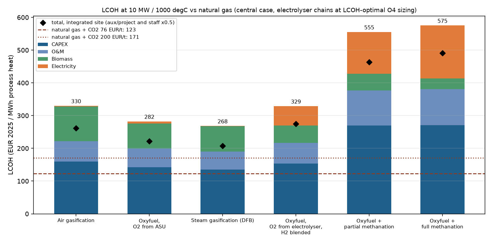
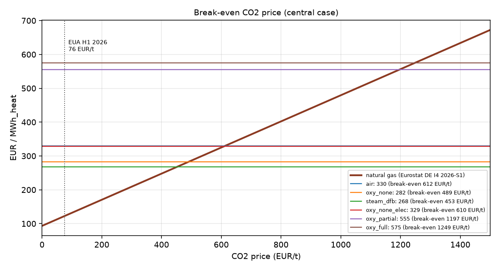
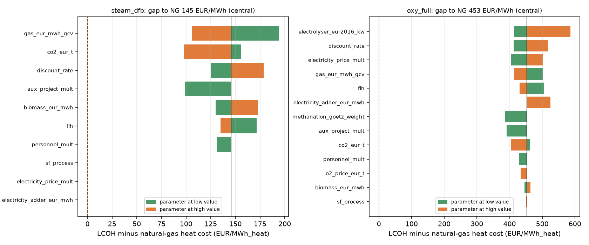
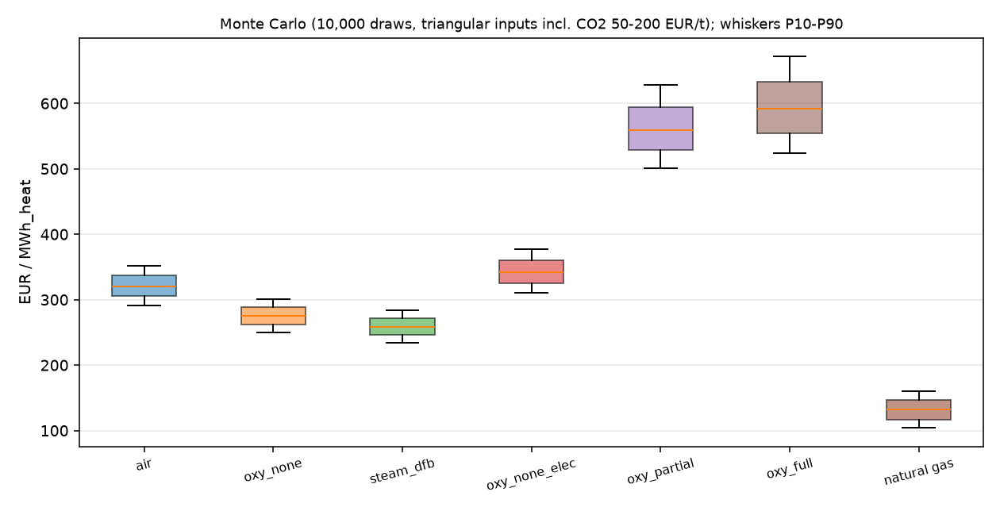
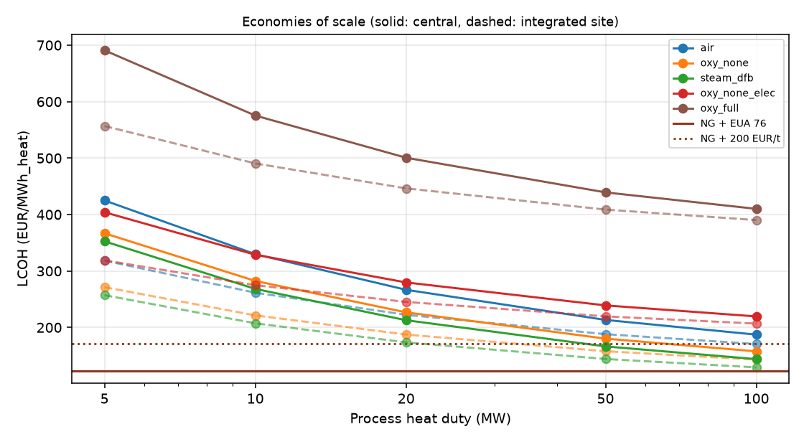

# Biomass Heat: LCOH vs Natural Gas

**Levelised cost of high-temperature process heat from biomass gasification chains,
compared with natural gas plus CO2 cost.** CAPEX and O&M come from published, DOI-checked
cost studies. Energy and mass balances come from the plant model, and electricity cost from
real German day-ahead dispatch. The repo works out break-even CO2 and gas prices and runs
tornado and Monte Carlo sensitivities.

This is step 4 of the [Biomass Process Heat](https://github.com/DataWithSyed/biomass-process-heat)
series. It depends on the two earlier packages:

```bash
pip install git+https://github.com/DataWithSyed/biomass-heat-plant-model.git
pip install git+https://github.com/DataWithSyed/biomass-heat-electrolysis-dispatch.git
```

## Problem

An industrial furnace needs **10 MW of heat with flue gas leaving at 1000 °C**. Today it burns
natural gas. Gasified biomass can replace it in several ways: air-blown, oxygen-blown (O2 from
an ASU or an electrolyser) or steam (dual fluidised bed). The oxygen-blown routes can add
partial or full methanation with electrolytic H2. Which chain gives the cheapest heat? How far
is it from gas, and what CO2 price closes the gap?

## Method

1. **Technical inputs** per chain from
   [`biomass-heat-plant-model`](https://github.com/DataWithSyed/biomass-heat-plant-model):
   biomass, fuel-gas and electricity per MWh of heat, O2 from an ASU, and the electrolyser rating.
2. **Electricity cost** for the electrolyser chains comes from
   [`biomass-heat-electrolysis-dispatch`](https://github.com/DataWithSyed/biomass-heat-electrolysis-dispatch).
   It uses the realisable O4 strategy (rolling day-ahead LP) on real DE-LU day-ahead prices
   (Energy-Charts, CC BY 4.0), 2025-10-30 → 2026-10-30, mean 110.8 EUR/MWh. Electrolyser size
   (1–4× design) and H2/O2 storage (0–48 h) are picked by **minimum LCOH including their
   CAPEX** (42-point grid per chain).
3. **CAPEX/O&M** ([docs/cost_basis.md](docs/cost_basis.md)):
   * gasification island, methanation section, auxiliary/project costs and O&M are scaled from
     the **GoBiGas** cost data (Thunman et al. 2019, Tables 2–4, with their scale factors);
   * electrolyser: Schmidt et al. 2017 (AEC 1000–1200 EUR/kW, stack life 60–90 kh);
   * H2/O2 storage and an alternative methanation cost: Götz et al. 2016 (Table 8; Outotec points);
   * everything converted to **EUR 2025** with the euro-area HICP (Eurostat).
4. **LCOH** = annuity (7 %, 20 y) of CAPEX + 10 % development cost + fixed O&M + stack
   replacement + biomass + electricity − O2 sales, divided by heat (10 MW × 8000 h).
5. **Natural-gas reference**: same furnace, so the cost is fuel plus CO2 only. Gas price from
   Eurostat (DE, band I4, excl. taxes/levies, **44.1 EUR/MWh GCV, 2026-S1**). CO2 at the EUA
   price (**76.02 EUR/t**, DEHSt German auctions H1 2026). Fossil CO2 is 0.386 t per MWh of
   heat (plant model).
6. **Break-even** CO2 and gas prices. **Tornado** on the gap to gas (14 parameters).
   **Monte Carlo**: 10,000 triangular draws with common random numbers. **Scale sweep**: 5–100 MW.

## Key results (v0.1, central case, EUR 2025 per MWh of process heat)

Natural gas: **122.7 EUR/MWh_heat** (fuel 93.4 + CO2 29.3).

| Chain | LCOH | CAPEX | O&M | Biomass | Electricity | Total CAPEX (MEUR) | Break-even CO2 (EUR/t) |
|---|---|---|---|---|---|---|---|
| Steam gasification (DFB) | **268** | 135 | 55 | 77 | 1 | 115 | **453** |
| Oxyfuel, O2 from ASU | 282 | 142 | 57 | 77 | 6 | 120 | 490 |
| Oxyfuel, O2 from electrolyser, H2 blended (2.5×, 24 h) | 329 | 153 | 64 | 53 | 59 | 130 | 610 |
| Air gasification | 330 | 160 | 63 | 106 | 2 | 135 | 612 |
| Oxyfuel + partial methanation (2.5×, 24 h) | 555 | 269 | 108 | 50 | 128 | 228 | 1197 |
| Oxyfuel + full methanation (2.5×, 24 h) | 575 | 270 | 111 | 33 | 161 | 229 | 1249 |



What the numbers say:

* **At 10 MW, no chain is close to gas.** The cheapest is DFB steam gasification at 268 vs
  123 EUR/MWh. It needs a CO2 price of **≈ 450 EUR/t** to break even, or a gas price of
  113 EUR/MWh_GCV (2.6× the 2026-S1 price). Even with **zero CAPEX** it would not beat gas at
  76 EUR/t, because O&M and biomass alone come to 133 EUR/MWh. At 200 EUR/t the whole plant
  would have to cost **≤ 32 MEUR** against the 115 MEUR scaled from GoBiGas.
* **The chain's energy efficiency drives fuel cost.** At 1000 °C only about 39–52 % of the
  fuel LHV is usable heat (no recuperation). Air gas needs 3.5 MWh of biomass per MWh of heat,
  against 2.5 for oxygen/steam gas.
* **Electrolytic H2 for methanation doubles the cost.** At 2025-26 German power prices, full
  methanation's electricity alone (161 EUR/MWh_heat after optimised dispatch) exceeds the
  whole gas reference. The 2.4 MWh_el per MWh_heat also needs a ~59 MW electrolyser. Break-even
  CO2 price is **> 1,200 EUR/t**.
* **Flexible operation pays, but only a little, once CAPEX is counted.** For full methanation,
  going from 1× follow-demand (612) to 2.5× electrolyser + 24 h storage on rolling day-ahead
  dispatch (575) saves 37 EUR/MWh (6 %). The optimum is flat: 1.5–2.5× with 12–24 h storage are
  all within ~1.5 % ([sizing heat map](figures/05_sizing_oxy_full.png)).
* **Site integration and scale are the levers.** In an *integrated site* case
  (auxiliary/project costs and staff halved, an assumption) DFB falls to 207 EUR/MWh with a
  break-even CO2 price of **295 EUR/t**. Adding low cost assumptions as well (Götz methanation,
  2030 electrolyser cost, Thunman's cheaper forest residue) gives 192 and 255 EUR/t. Scaling
  up to **100 MW of heat** brings DFB to 144 EUR/MWh (131 EUR/t), or 129 EUR/MWh
  (**93 EUR/t**) integrated. That is near today's EUA price.



**Sensitivity.** For DFB, the gap to gas moves most with the gas price (±88 EUR/MWh over
21–63 EUR/MWh_GCV), the CO2 price (58), the discount rate (53), the auxiliary/project cost
share (47) and the biomass price (43). For full methanation, the electrolyser CAPEX (171),
the discount rate (107) and the electricity price (97) dominate.
In the **Monte Carlo** (10,000 draws; CO2 50–200 EUR/t; gas, biomass, CAPEX, power, FLH and
rate all varied), **no chain beats gas in any draw** at 10 MW. DFB P10–P90 is 234–284 against
gas at 104–160 EUR/MWh.







## How to run

```bash
python -m venv .venv && source .venv/bin/activate
pip install -r requirements.txt
python scripts/run_lcoh.py      # ~2.5 min (129 dispatch runs + 10k Monte Carlo draws)
pytest -q                       # 19 tests
```

Outputs go to `results/`: `lcoh_results.csv` (3 scenarios × 6 chains),
`lcoh_breakdown_central.csv`, `sizing_grid_O4.csv`, `tornado_gap_to_ng.csv`,
`monte_carlo_summary.csv`, `scale_sweep.csv`, `run_meta.json`. Figures go to `figures/`.
Library use:

```python
from bhlcoh import central_inputs, chain_inputs, lcoh_breakdown, ng_lcoh, breakeven_co2_price
c = central_inputs()
ch = chain_inputs("steam_dfb", mean_price=110.8)
b = lcoh_breakdown(ch, c)               # EUR/MWh_heat by component
breakeven_co2_price(b["total"], c)      # EUR/t
```

## Assumptions

* Cited and derived values with their sources: [docs/cost_basis.md](docs/cost_basis.md).
* My own engineering assumptions: [docs/assumptions.md](docs/assumptions.md) (L-A1…L-A18).
  The main ones: the **ASU CAPEX is an unsourced order-of-magnitude value** (it only affects
  `oxy_none`, by about 6.5 EUR/MWh). The **same GoBiGas-scaled gasification island is used for
  air, oxygen and DFB gasifiers**. The "integrated site" ×0.5 factors are an assumption. No
  grid fees are added to the day-ahead price. Surplus O2 is vented in the central case.
* Plant-model (A1–A23) and dispatch (A-D1…) assumptions carry over.

## Limitations

* **The CAPEX basis is first-of-a-kind and bio-SNG grade.** GoBiGas was built with petrochemical
  redundancy. A simple fuel-gas gasifier for a kiln may cost much less. The *capex for parity*
  column in `results/lcoh_results.csv` shows the plant cost each chain would need instead.
* HICP escalation probably *understates* 2025 plant costs. Plant-cost indices rose faster
  after 2021, and the commercial indices (e.g. CEPCI) are not open data.
* The electrolyser costs (Schmidt 2017) are pre-2020 system costs. Installed project costs
  reported since then are often higher. The tornado high case (2320 EUR/kW) partly covers this.
* Burner/furnace retrofit for low-calorific gas, gas-quality limits, part load and heat
  recovery (recuperation would cut fuel per MWh for every chain, gas included) are not modelled
  yet. They belong to the scenarios step and plant-model enhancements.
* A single year of prices, perfect availability of the electricity series, no correlation
  between gas, power and CO2 prices in the Monte Carlo, no taxes or subsidies.
* The 19 MW_th gas furnace is below the EU ETS 1 combustion threshold (20 MW). In practice the
  national CO2 price (BEHG) / ETS 2 would apply, and the 50–200 EUR/t range covers it.

## Repository layout

```
src/bhlcoh/costs.py        cost and price inputs with sources, HICP escalation, ranges
src/bhlcoh/chains.py       per-chain inputs (plant model + dispatch) and LCOH build-up
src/bhlcoh/reference.py    natural-gas reference, break-even CO2 / gas price
src/bhlcoh/dispatch.py     electricity cost via biomass-heat-electrolysis-dispatch
src/bhlcoh/sensitivity.py  tornado and Monte Carlo
scripts/run_lcoh.py        full study -> results/, figures/
data/                      DE-LU day-ahead cache (CC BY 4.0), Eurostat extracts (CC BY 4.0)
docs/                      cost basis, assumptions, CI example
```

## Licence and data

Code: MIT, see [LICENSE](LICENSE). Day-ahead prices: Energy-Charts.info (Fraunhofer ISE),
CC BY 4.0, source Bundesnetzagentur | SMARD.de. Gas prices and HICP: Eurostat, CC BY 4.0.
Wood-chip prices: individual figures cited from C.A.R.M.E.N. e.V. (not redistributed). EUA
price: DEHSt auction reports.
